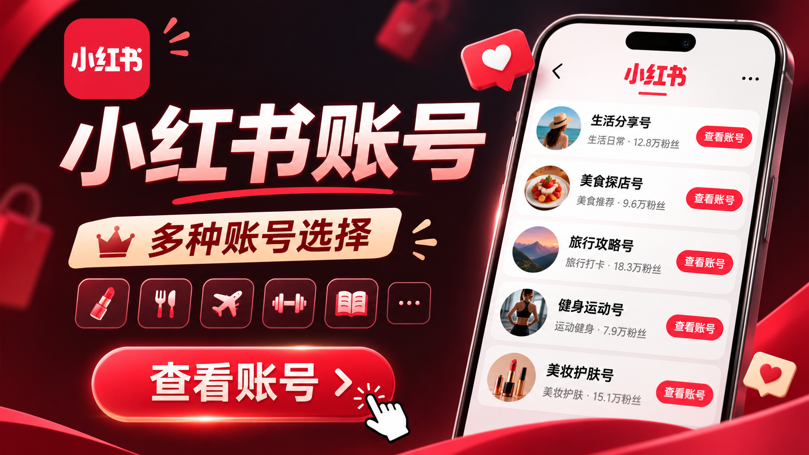

# 购买小红书老号出售

随着内容营销、品牌种草和个人创业需求增加，部分用户开始关注小红书老号出售，希望借助已有的注册时间、内容记录或互动基础，减少新账号从零运营的周期。不过，账号交易并不是简单的买卖行为，涉及平台规则、实名信息、账号安全和后续运营等多个问题，选择前应充分了解风险，避免因贪图“成熟账号”而造成资金或数据损失。

[➡️➡️➡️ 账号批发精选自助选购](https://twonvo.com/)

小红书账号交易的风险与理性选择

小红书老号出售需要关注哪些问题

首先要确认账号的真实状态。所谓“老号”不一定代表权重高，也不意味着发布内容后就能获得更多曝光。有些账号注册时间较早，但长期没有活跃记录，甚至存在违规、限流或异常登录历史。购买前应查看账号的笔记数量、互动质量、粉丝来源、账号等级、专业号状态以及是否有违规提示。

其次要核实粉丝的真实性。部分卖家会使用刷粉、刷赞或批量关注的方式制造数据，看起来粉丝数量不少，实际互动却非常低。例如，一个拥有两万粉丝的账号，普通笔记只有几十次浏览和个位数点赞，就可能存在粉丝质量偏低的问题。相比单纯追求粉丝规模，更应该关注粉丝是否与目标行业匹配，以及评论、收藏和私信是否具有真实价值。

在搜索小红书老号出售信息时，还要特别警惕低价诱导、先付款后失联、账号资料不完整等情况。较为稳妥的做法是选择能够提供清晰交易流程的平台或服务方，确认账号交接范围、售后期限、异常处理方式和退款条件。交易过程中不要将身份证照片、银行卡密码、短信验证码等敏感信息交给陌生人。

购买或接手账号前的检查清单

第一，检查账号绑定情况，包括手机号、邮箱、第三方登录方式和实名认证状态。若原持有人无法完成解绑，后续可能出现找回账号、无法提现或身份验证失败等问题。第二，查看历史内容，判断账号定位是否与自己的业务一致。一个原本发布美妆内容的账号，突然大量发布房产或教育信息，容易导致原有用户流失，也可能影响内容表现。

第三，确认账号是否存在商业合作纠纷、侵权笔记或未完成的品牌任务。比如，账号曾经接受品牌推广，却没有按约定发布内容，接手后可能继续面对投诉。第四，保留聊天记录、付款凭证、账号截图和交接文件，以便在发生争议时维护自身权益。

比直接买号更稳妥的运营方式

对于大多数个人创作者和中小商家来说，重新注册并运营账号往往更加安全。可以先确定细分方向，例如本地探店、职场经验、母婴知识或家居分享，再通过稳定更新建立账号标签。前期不必急于追求爆款，而应重视标题表达、封面清晰度、内容原创性和评论区互动。

如果确实需要接手已有账号，建议将其视为一个新的运营项目，而不是立即改变内容方向。可以先用一到两周观察账号数据，逐步调整选题，避免短时间内大量删除旧笔记或频繁修改资料。同时，不要发布夸大宣传、虚假测评、违规导流等内容，持续遵守平台规则，才能降低限流和封禁风险。

总结

小红书老号出售看似能够节省冷启动时间，但账号价值不能只用注册年限和粉丝数量衡量。真实互动、内容历史、账号安全和平台合规性，才是决定账号是否值得接手的关键。无论选择交易还是自主运营，都应先核实信息、明确风险、保护隐私，并通过持续提供有价值的原创内容建立长期竞争力。